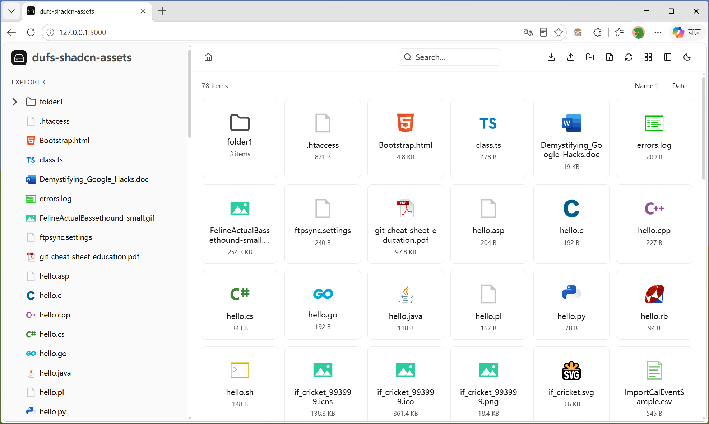
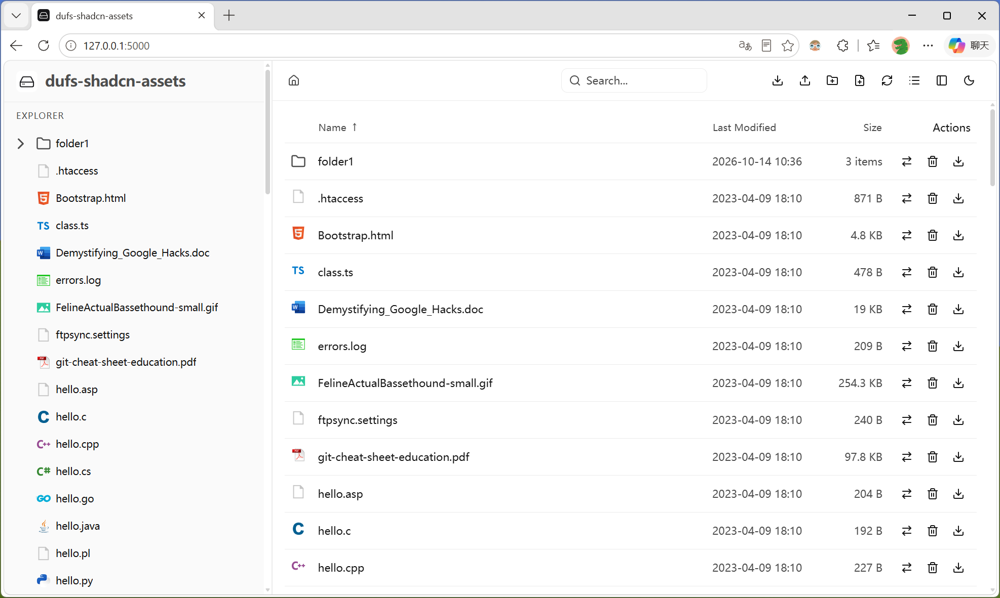
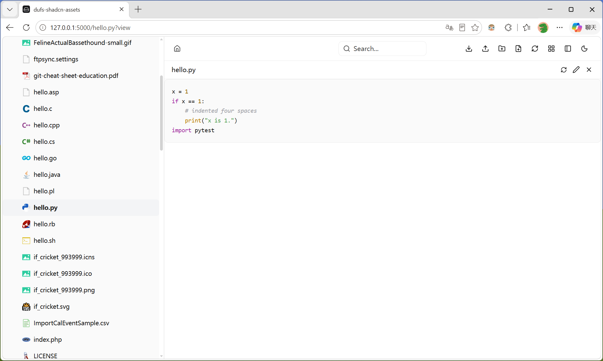
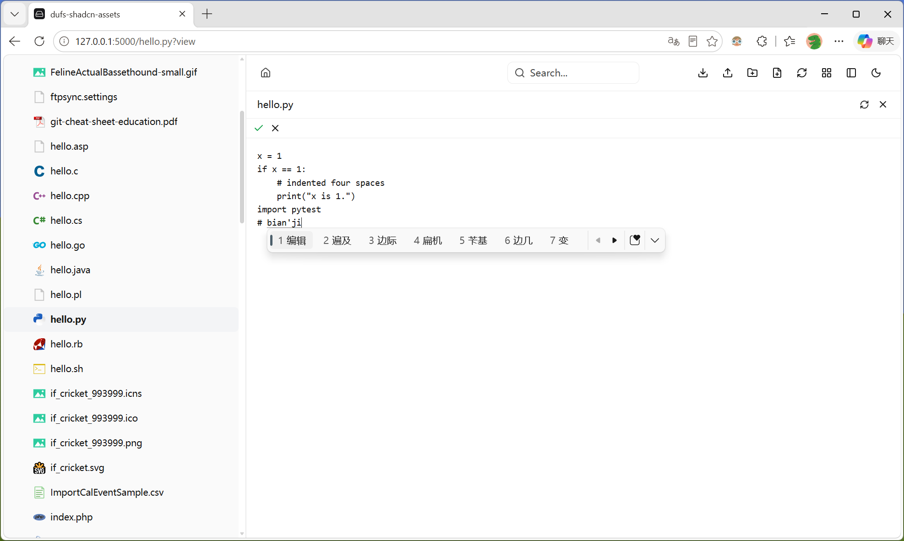
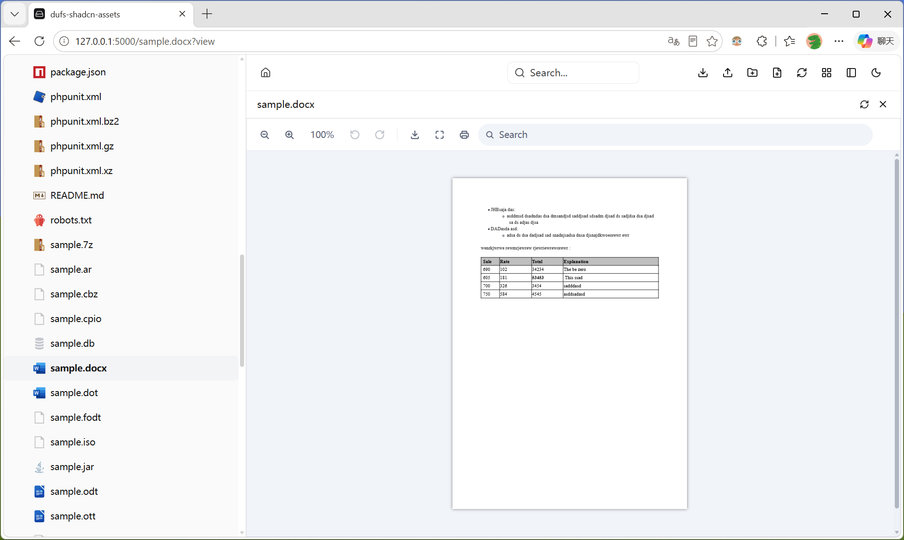
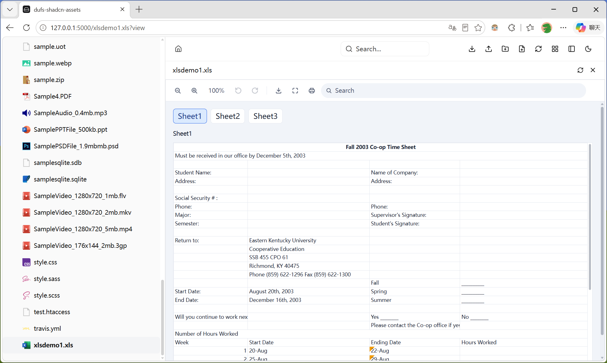
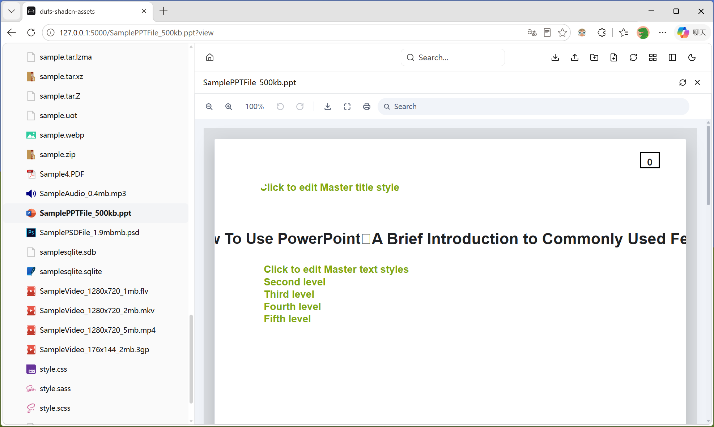
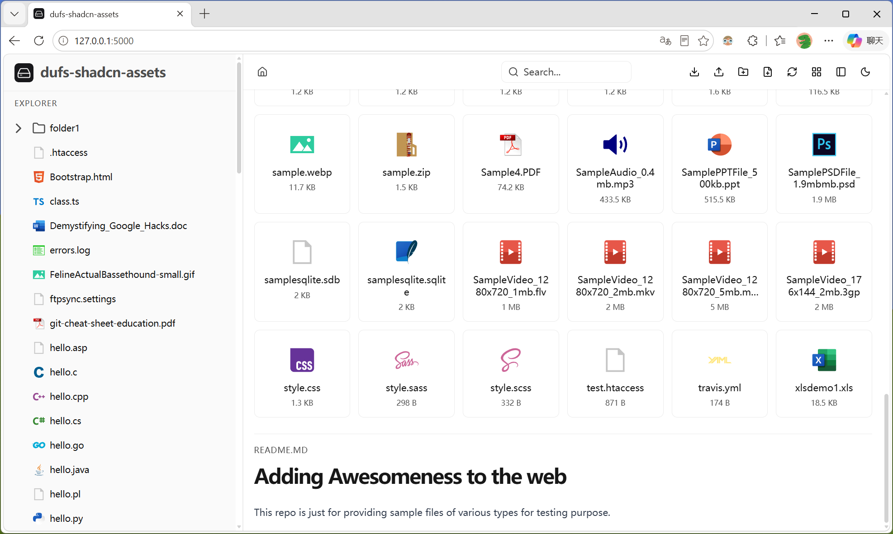
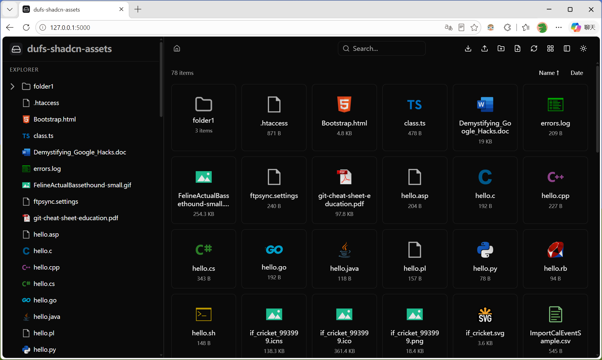

<p align="center">
  
</p>

# dufs-shadcn-assets

> **dufs 的前端主题项目** — 通过 `dufs --assets` 替换 dufs 内置 UI 的现代化文件管理界面。

基于 [shadcn/ui](https://ui.shadcn.com/) 构建。文件预览能力由 Open File Viewer 提供，覆盖 30+ 种文件格式。

## 亮点

<p align="center">
  
</p>

- **1132 个 vscode-icons 文件图标** — 自动识别 599 种扩展名 + 1923 种文件名 + 524 种文件夹名，媲美 VS Code 的文件图标体验
- **双视图模式** — 图标视图 / 列表视图自由切换，可通过 `config.json` 配置默认模式
- **富媒体文件预览** — 支持 Office 文档、PDF、图片、视频、音频、3D 模型、CAD、GIS 地图、电子书、压缩包等 30+ 格式在线预览
- **侧边栏文件树** — 虚拟滚动 + 懒加载 + 自动跟随导航展开选中，大数据量目录也流畅
- **Vercel Geist 风格** — 深浅色双主题，手动切换 / 跟随系统偏好，CSS 变量体系完备
- **完全离线可用** — 单文件构建，所有资源内联，无任何 CDN 依赖
- **上传增强** — 队列串行上传、断点续传、文件夹递归拖拽、离开保护、上传前认证检查
- **品牌可定制** — Logo、标题、颜色、默认视图全部通过 `config.json` 配置，运行时生效

## 快速开始

从 [Releases](../../releases) 页面下载最新的 `dufs-shadcn-assets.zip`，解压后直接使用：

```bash
# 解压到任意目录，例如 ./assets
unzip dufs-shadcn-assets.zip -d ./assets

# 启动 dufs，指定 assets 目录
dufs ./serve-path --assets ./assets
```

## 特性一览

### 文件管理与导航

- **侧边栏文件树** — 虚拟滚动树形目录，懒加载子节点，自动跟随浏览位置展开并选中
- **面包屑导航** — 分段路径点击跳转，支持中文路径，Home 图标一键回根
- **搜索** — 居中搜索栏，后端 `?q=` 查询，URL 参数持久化
- **SPA 路由** — `pushState` + `popstate`，浏览器前进后退完整支持

<p align="center">
  
  <br><em>列表视图 — 排序、操作按钮、面包屑导航</em>
</p>

### 文件操作

| 操作 | 说明 |
|------|------|
| 上传 | 多文件选择 / 拖拽上传 / 文件夹递归拖拽 |
| 下载 | 单文件下载 / 目录 ZIP 打包下载 / 认证 token 自动生成 |
| 新建 | 创建文件夹 (MKCOL) / 创建文件 (PUT) |
| 删除 | 确认对话框，操作后自动刷新 |
| 移动/重命名 | 对话框输入新路径，MOVE 方法 + 目标确认 |
| 刷新 | 工具栏一键刷新当前目录 |

### 上传增强

- **队列串行** — 多文件上传按顺序逐一处理，避免并发问题
- **断点续传** — 失败后 HEAD 获取已传字节，PATCH + `X-Update-Range: append` 续传
- **文件夹拖拽** — `webkitGetAsEntry` 递归遍历，自动 MKCOL 创建子目录后上传
- **离开保护** — 上传进行中 `beforeunload` 阻止页面关闭
- **认证预检** — 上传前自动 `CHECKAUTH` 检验认证状态

### 文件预览

- **文本/代码** — highlight.js 语法高亮，30+ 语言支持，智能 UTF-8/GBK 编码检测
- **Markdown** — 目录下 README.md 自动渲染，GFM 表格/任务列表/代码块完整支持
- **富媒体预览 (OFV)** — 基于 [Open File Viewer](https://github.com/shinokada/open-file-viewer)，支持 Office 文档 (.docx/.pptx/.xlsx)、PDF、图片 (.png/.jpg/.gif/.webp/.svg/.psd)、视频 (.mp4/.mkv/.mov/.avi)、音频 (.mp3/.wav/.ogg)、3D 模型 (.glb/.gltf)、CAD (.dwg/.dxf)、GIS (.geojson/.kml)、压缩包 (.zip/.tar/.7z/.gz)、电子书 (.epub)、邮件 (.eml)、XMind 思维导图 等 30+ 格式
- **在线编辑** — 可编辑文本文件支持 Ctrl+S 保存、Esc 取消

<p align="center">
  
  
  <br><em>代码语法高亮预览 & 在线编辑</em>
</p>

<p align="center">
  
  
  
  <br><em>Office 文档在线预览：Word · Excel · PowerPoint</em>
</p>

<p align="center">
  
  <br><em>目录下 README.md 自动渲染</em>
</p>

### 图标系统

从本地 VS Code 扩展解析 `vsicons-icon-theme.json`，构建时自动生成 1132 个图标 + 完整映射表。匹配顺序：

1. 完整文件名匹配（`.gitignore` → `file_type_git`）
2. 双扩展名匹配（`.tar.gz` → `file_type_zip`）
3. 单扩展名匹配（`.js` → `file_type_js`）
4. 常用扩展名回退（65 个硬编码映射）
5. 默认文件图标

特定文件夹名（`.git`、`node_modules`、`src` 等）自动匹配对应的文件夹图标。暗色模式下自动应用亮度/饱和度滤镜保持辨识度。

### 主题系统

- **深浅色双主题** — 工具栏一键切换，手动切换 / 跟随系统偏好自动检测
- **Vercel Geist 风格** — `shadow-as-border` 技巧，精细的圆角和间距
- **Sidebar 独立配色** — 侧边栏与主内容区视觉分离
- **细滚动条** — 6px 主题色滚动条，hover 加深
- **偏好持久化** — `localStorage` 保存主题和侧边栏宽度

<p align="center">
  
  <br><em>深色模式 — 暗色主题 + vscode-icons 暗色适配</em>
</p>

### 认证支持

- HTTP Basic Auth 集成
- Login/Logout 按钮，`CHECKAUTH` 方法触发浏览器认证对话框
- 下载时自动生成临时 token
- 上传前认证预检

### Logo / 品牌定制

将所有配置和资源文件放在 `.dufs_shadcn_assets/` 目录下，放到数据目录根路径（即 dufs 服务的目录）下即可生效，无需重新构建：

```
serve-path/
├── .dufs_shadcn_assets/
│   ├── config.json
│   ├── logo.svg
│   ├── logo-dark.svg
│   └── favicon.svg
├── your-files...
└── config.json              ← dufs 原生配置（仅 theme 字段，消除 404）
```

> **注意**：`.dufs_shadcn_assets/` 目录不会出现在文件树和文件列表中，已系统级屏蔽。

## 配置

### 自定义配置 (`.dufs_shadcn_assets/config.json`)

| 字段 | 类型 | 默认值 | 说明 |
|------|------|--------|------|
| `logo_text` | string | (空) | 侧边栏标题 / 浏览器标签页标题 |
| `logo` | string | (空) | 浅色模式 Logo 路径（相对于 `.dufs_shadcn_assets/`，如 `./logo.svg`） |
| `dark_logo` | string | (空) | 深色模式 Logo 路径 |
| `logo_size` | string | `28px` | Logo 图片尺寸 |
| `logo_text_font_size` | string | `20px` | 标题文字大小 |
| `view_mode` | string | `icons` | 默认视图模式 (`icons` / `list`) |
| `theme` | string | `light` | 默认主题 (`light` / `dark`) |
| `footer` | string | (空) | 文件区域底部文字，支持 HTML 标签 |
| `lock_edit_files` | string[] | `[]` | 禁止编辑的文件路径列表，如 `["/README.md"]` |

### 示例

```json
{
  "logo_text": "My Server",
  "logo": "./logo.svg",
  "dark_logo": "./logo-dark.svg",
  "view_mode": "list",
  "theme": "dark",
  "footer": "Powered By @<a style=\"text-decoration: underline\" href=\"https://github.com/mikigo\" target=\"_blank\">mikigo</a>",
  "lock_edit_files": [
    "/README.md"
  ]
}
```

### Dufs 原生配置 (`config.json`)

dufs 原生 UI 需要一个 `config.json` 放在数据目录根部，仅支持 `theme` 字段：

```json
{ "theme": "light" }
```

放置后可消除 `GET /config.json` 的 404 日志，不影响自定义配置。

## License

MIT